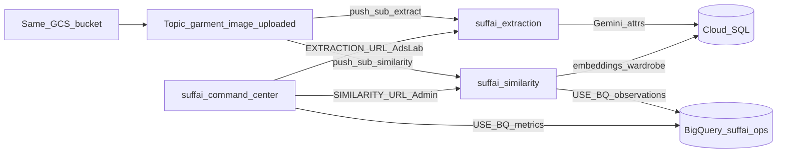

# Garment similarity service (`suffai-similarity`)

Independent Cloud Run service: on GCS image upload → Vertex multimodal embedding → per-user `user_wardrobe` + PIN counters.

Does **not** change `api/` or `worker/` source. Recommendations are out of scope for this phase.

**Step-by-step deploy + integrate + verify:** **[DEPLOY_SIMILARITY_E2E.md](DEPLOY_SIMILARITY_E2E.md)**  
(`./deploy/deploy_similarity_e2e.sh`)

## Integration consistency (vs extraction + command center)



| Concern | Extraction | Similarity | Command Center |
|---------|------------|------------|----------------|
| Trigger | Pub/Sub push `POST /` | **Same topic**, second push sub | N/A (HTTP BFF) |
| Payload parse | `parse_key_object_metadata` (objectId / JSON) | **Same function name & fields** | — |
| GCS | `GCS_IMAGE_BUCKET`, download + `gs://` URI | **Same bucket / env** | Upload Ads Lab to same bucket |
| Vertex | `ENABLE_VERTEX`, `vertexai.init`, **GCS URI first** then bytes | **Same pattern** (embeddings model) | — |
| Ack semantics | 200 client errors / 500 retry | **Same** | — |
| Auth | `--no-allow-unauthenticated` + OIDC push | **Same** | Public UI; ID-token to private services |
| Cloud SQL | `DATABASE_URL` operational SoT | **Same DB**, own tables | Optional job count |
| BigQuery | — | `USE_BQ` → `garment_similarity_observations` | `USE_BQ` → geo metrics |
| Env names | `GOOGLE_CLOUD_PROJECT`, `VERTEX_LOCATION`, `GCS_IMAGE_BUCKET` | **Shared** + `VERTEX_EMBED_MODEL`, `BQ_DATASET` | Shared + `EXTRACTION_URL`, `SIMILARITY_URL` |

Vertex models differ by design: extraction = Gemini (`VERTEX_MODEL`); similarity = multimodal embeddings (`VERTEX_EMBED_MODEL`). Connection path (Pub/Sub → GCS read → `vertexai.init` → Vertex API) is the same.

## Upload contract (required)

Every image processed by similarity must carry **`user_uuid`** and **`pin_code`** via one of:

1. **GCS object custom metadata** (preferred): `user_uuid`, `pin_code`, optional `brand`
2. **Pub/Sub message attributes** with the same keys
3. **Object path**: `garments/{user_uuid}/{pin_code}/{filename}.jpg`

`pin_code` must be 6 digits. Missing context → event `skipped_missing_context` (no invent).

## Decision logic (Option 2 schema)

1. Embed image (Vertex URI-first, or stub if `ENABLE_VERTEX=false`)
2. Match against **this user’s** `user_wardrobe`
3. **Match** → do **not** insert wardrobe; increment `garment_pin_counts`
4. **No user match** → global NN; link or create `unique_garments` + `user_wardrobe` + PIN +1
5. If `USE_BQ=true`, append analytics row to BQ

## Tables (Option 2 — Cloud SQL)

```bash
psql "$DATABASE_URL" -f db/migrations/003_garment_similarity.sql
psql "$DATABASE_URL" -f db/migrations/004_rename_user_wardrobe.sql   # if upgrading
```

| Table | Grain | Role |
|-------|--------|------|
| `unique_garments` | `garment_id` | Catalog + embedding |
| `user_wardrobe` | `(user_uuid, garment_id)` | User unique set |
| `garment_pin_counts` | `(garment_id, pin_code)` | PIN counters |
| `garment_similarity_events` | audit | Idempotency |

## BigQuery (analytics)

```bash
bq query --use_legacy_sql=false < similarity/scripts/create_bq_similarity_tables.sql
# or create table in dataset BQ_DATASET (default suffai_ops)
```

Table: `garment_similarity_observations` (streaming inserts from the service).

## APIs

| Method | Path | Purpose |
|--------|------|---------|
| `GET` | `/health` | Health + flags |
| `POST` | `/` | Pub/Sub push |
| `POST` | `/v1/similarity/process` | Direct / backfill |
| `GET` | `/v1/admin/unique-garments/summary` | Admin KPIs (Cloud SQL) |
| `GET` | `/v1/admin/unique-garments` | Admin list |

## Deploy

```bash
cd AI_CUP_updated
export GOOGLE_CLOUD_PROJECT=YOUR_PROJECT GCP_REGION=asia-south1
export ENABLE_VERTEX=true
export DATABASE_URL='postgresql://…'
export CLOUD_SQL_INSTANCE=PROJECT:REGION:INSTANCE

# Cloud SQL + BQ DDL
psql "$DATABASE_URL" -f db/migrations/003_garment_similarity.sql
bq query --use_legacy_sql=false < similarity/scripts/create_bq_similarity_tables.sql

# Similarity + OIDC Pub/Sub push on garment-image-uploaded
./deploy/deploy_similarity.sh

# Command Center with both sibling URLs
export EXTRACTION_URL=$(gcloud run services describe suffai-extraction --region=$GCP_REGION --format='value(status.url)')
export SIMILARITY_URL=$(gcloud run services describe suffai-similarity --region=$GCP_REGION --format='value(status.url)')
./deploy/deploy_command_center.sh
```

Or full stack: `./deploy/deploy_cloud_run.sh` then `./deploy/deploy_similarity.sh` to finish Pub/Sub OIDC wiring.

**Subscriptions on the same topic:**

- Extraction: existing `garment-image-uploaded-push` (unchanged)
- Similarity: `garment-image-uploaded-similarity-push`

## Command Center

| Tab | Backend |
|-----|---------|
| Geo / Ads Lab | BQ metrics + `EXTRACTION_URL` |
| Admin | `SIMILARITY_URL` → unique wardrobe / PIN aggregates |

CC calls private services with Google ID tokens (same pattern as Ads Lab → extraction).

## Env

| Var | Default | Notes |
|-----|---------|-------|
| `GCS_IMAGE_BUCKET` | `{project}-suffai-garment-images` | Shared with extraction |
| `DATABASE_URL` | — | Cloud SQL |
| `ENABLE_VERTEX` | `true` | Shared gate with extraction |
| `VERTEX_LOCATION` | `asia-south1` | Shared |
| `VERTEX_EMBED_MODEL` | `multimodalembedding@001` | Similarity-only |
| `USE_BQ` / `BQ_DATASET` | `true` / `suffai_ops` | Same as command center |
| `SIMILARITY_THRESHOLD` | `0.92` | Cosine |

## IAM (runtime SA)

- `roles/storage.objectViewer` on image bucket  
- `roles/aiplatform.user` (Vertex)  
- Cloud SQL Client  
- `roles/bigquery.dataEditor` (or jobUser + dataset write) when `USE_BQ=true`  
- Pub/Sub push SA: `roles/run.invoker` on `suffai-similarity`

## Local

```bash
export ENABLE_VERTEX=false USE_BQ=false DATABASE_URL=postgresql://… GOOGLE_CLOUD_PROJECT=…
uvicorn similarity.main:app --host 127.0.0.1 --port 8084
```
